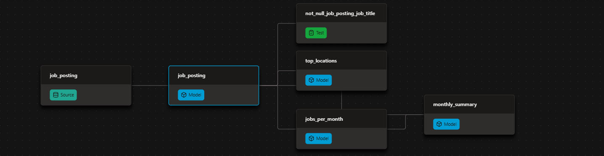

# Automated Job Postings pipeline (v2) - dbt + DuckDB

## A public dbt + DuckDB pipeline over ~692k real job postings, rebuilt and republished automatically on every push.

- Models the raw postings into tested, documented insight marts.
- Publishes the docs site and the finished warehouse — open to anyone, no credentials.
- Runs itself on GitHub Actions: every push and every Monday.

v1 of this pipeline — everything free and local-friendly: DuckDB as the warehouse, GitHub Actions as the scheduler. v2 rebuilds it production-grade on Databricks.

| What I Built | How I Implemented | Where to Look |
| :--- | :--- | :--- |
| dbt pipeline | sources -> cleaned model -> insight marts | [analytics/models](https://github.com/Abdelmonim809/dbt-duckdb-pipeline/tree/70eb3ba75762a9f933fedd8ab2e8e4938729886c/analytics/models)
| Data tests | *unique* / *not_null* on every mart grain | [schema.yml](analytics/models/schema.yml)|
| Hosted dbt docs | lineage, descriptions, column tests | [Hosted project portal / site]() |
| Public CI | build + test + publish on every push | [GitHub Actions workflow files](.github/workflows/dbt_build.yml) |
| Environments | local dev vs CI prod targets | [ci/profiles.yml config](https://github.com/Abdelmonim809/dbt-duckdb-pipeline/blob/70eb3ba75762a9f933fedd8ab2e8e4938729886c/ci/profiles.yml)|
| Published warehouse | one ATTACH, queryable by anyone | [Production connection query](https://github.com/Abdelmonim809/dbt-duckdb-pipeline/releases/download/warehouse/prod.duckdb) |

### ⚙️ The dbt Pipeline
 Raw postings flow through three dbt layers — declared sources → cleaned staging views → insight marts — with tests gating every build. The DAG below is the whole flow:

